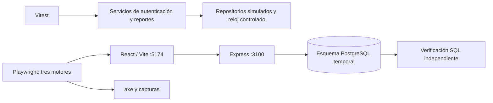
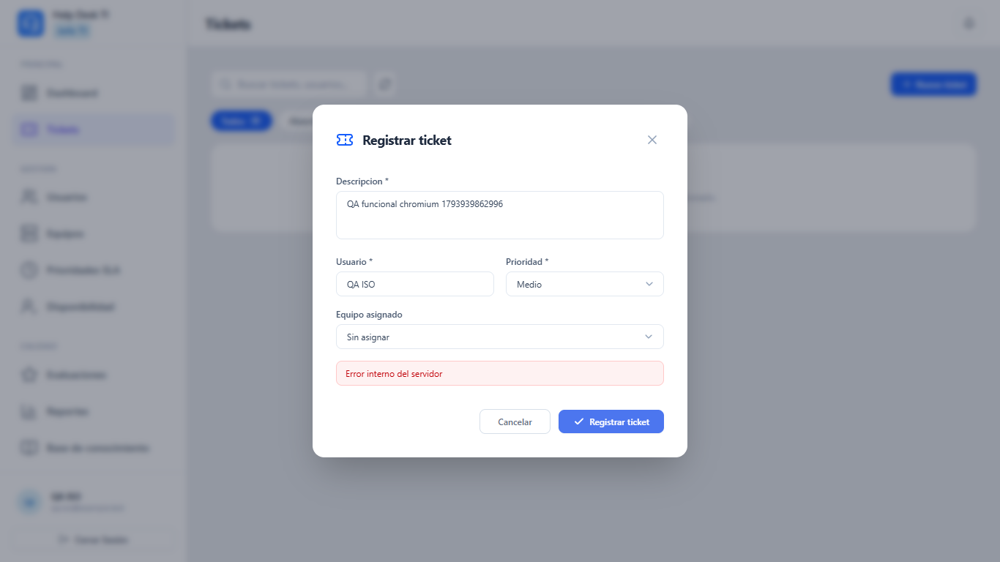
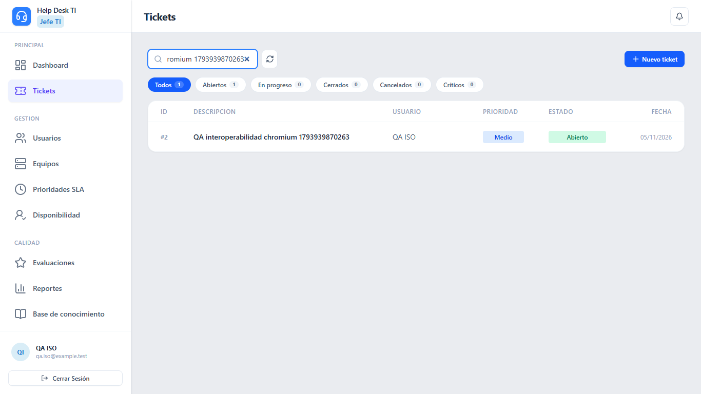
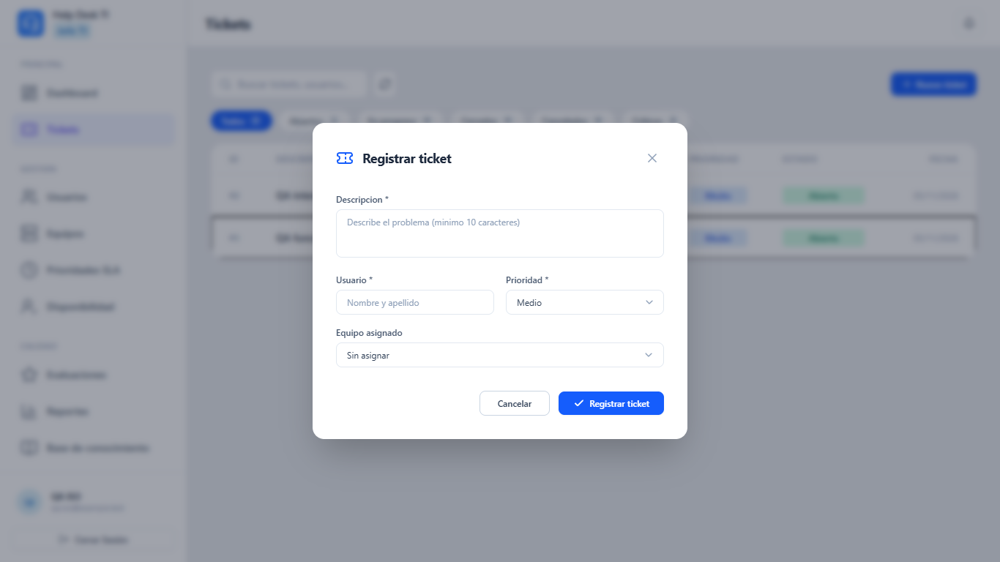
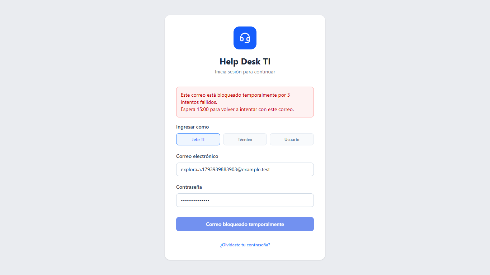
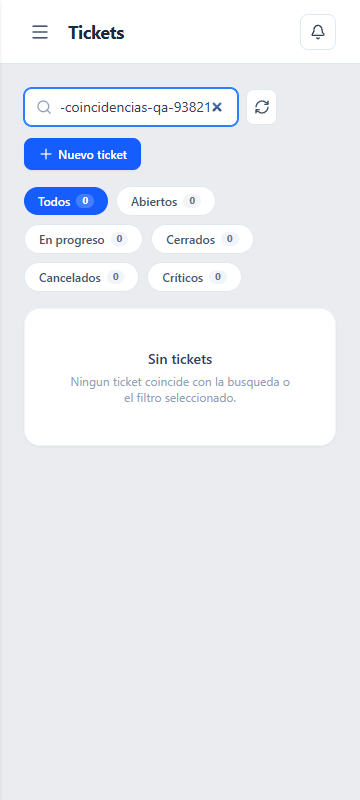

# Avance 3 — Evaluación de calidad con ISO/IEC 25010

**Proyecto:** Sistema web de Gestión de Incidencias con SLA — Quimesa.  
**Curso:** Integrador II: Software.  
**Fecha:** 5 de noviembre de 2026, hora de Lima.  
**Alcance:** seis bloques de pruebas sobre autenticación, tickets, SLA e interacción.  
**Costo de herramientas:** S/ 0 en licencias y servicios de pruebas; ejecución local con conexión a PostgreSQL configurada.

### Resultado de la evaluación

| Bloque | Resultado real | Evaluación |
|---|---|---|
| P1 — Unitarias de bloqueo | 4/4 aprobadas. | Dentro del criterio local. |
| P2 — Unitarias SLA | 7/7 aprobadas. | Dentro del criterio local. |
| P3 — Registro de tickets | Los tres motores rechazan correctamente datos incompletos y permiten crear con equipo. Sin equipo, los tres devuelven HTTP 500 en lugar de 201. | Requiere mejora; el bloque falla en los tres motores. |
| P4 — Interoperabilidad | 3/3 recorridos aprobados: UI → API → PostgreSQL → recarga, con equipo seleccionado. | Dentro del criterio local para ese recorrido. |
| P5 — Interacción | Contraste insuficiente y cuatro carencias de diálogo: foco inicial, confinamiento, restauración y nombre accesible. | Requiere mejora. |
| P6 — Exploración asistida | Recorrido completado y bitácora generada; se observaron aviso no conservado al recargar y recorte visual en pantalla pequeña. | Ejecutada con hallazgos; pendiente ampliar con usuarios humanos. |

**Conteo:** 11/11 casos unitarios aprobados. En navegador: ocho ejecuciones realizadas, cuatro aprobadas y cuatro fallidas; otras cuatro combinaciones se omitieron por diseño. Las omitidas no cuentan como aprobadas. No se convierte este conteo en un «porcentaje de cumplimiento ISO».

## 1. Qué es ISO y qué es ISO/IEC 25010

ISO es la Organización Internacional de Normalización. ISO/IEC 25010 es un modelo que ayuda a definir y evaluar la calidad de un producto de software. La edición 2023 agrupa propiedades de calidad en nueve características; permite establecer requisitos, objetivos de prueba y criterios de evaluación. Véase la [ficha oficial de ISO/IEC 25010:2023](https://www.iso.org/standard/78176.html).

Para este avance se seleccionan **adecuación funcional, compatibilidad y capacidad de interacción**. La evaluación es parcial: no se presenta como certificación ni como cumplimiento de toda la norma. En la edición 2011, el área equivalente de interacción se trataba bajo usabilidad; aquí se utiliza la edición 2023.

### Qué pide evaluar y cómo se traduce al proyecto

Las siguientes descripciones son una aplicación al proyecto, no una reproducción de cláusulas ni un listado exhaustivo de la norma.

| Característica | Qué se busca evaluar | Aplicación concreta |
|---|---|---|
| Adecuación funcional | Funciones que cubran los requisitos, produzcan resultados correctos y permitan realizar la tarea. | Bloqueo individual por correo, registro de tickets y cálculo del SLA. |
| Compatibilidad | Intercambio correcto de información e interacción con otros componentes; contempla interoperabilidad y coexistencia. | React → API Express → PostgreSQL. Se añaden recorridos entre motores de navegador como evidencia complementaria. |
| Capacidad de interacción | Que el usuario pueda comprender y operar el producto, reconocer errores y acceder a las tareas. | Formularios, mensajes, teclado y revisión automática de accesibilidad. |

**ISO 25010 no obliga a usar Playwright o Vitest ni fija los porcentajes elegidos en este documento.** Los umbrales son decisiones del proyecto para el alcance evaluado. La ficha pública de la norma es consultable gratuitamente; su texto completo oficial se comercializa. No se compró ninguna licencia para estas pruebas.

## 2. Por qué se eligieron seis pruebas

El conjunto recorre la lógica interna, una tarea visible para el usuario, la persistencia real, varios motores y la interacción. Se eligieron seis bloques con varios casos cada uno; seis bloques no significan seis únicas aserciones.

| ID | Tipo de prueba | HU / alcance | Relación con ISO 25010 | Criterio local de aceptación |
|---|---|---|---|---|
| P1 | Unitaria: bloqueo del login | HU01 | Adecuación funcional: corrección | Los cuatro casos deben aprobar. |
| P2 | Unitaria: cálculo SLA | HU20 | Adecuación funcional: corrección | Los siete casos deben aprobar. |
| P3 | Funcional de extremo a extremo | HU06–HU07 | Adecuación funcional | Rechazar entrada inválida, crear ticket válido y mostrarlo; aprobar en los tres motores. |
| P4 | Integración real y compatibilidad entre motores | HU06–HU07 | Compatibilidad: interoperabilidad; navegadores como complemento | Registro real en PostgreSQL y consulta tras recargar en los tres motores. |
| P5 | Interacción y accesibilidad | Login y modal de ticket | Capacidad de interacción | Cero hallazgos axe serios/críticos en las vistas examinadas y foco correcto al abrir, recorrer y cerrar modal. |
| P6 | Exploración guiada asistida | Login, tickets y pantalla pequeña | Apoya adecuación funcional e interacción | Registrar acciones, observaciones y problemas; no asignar un porcentaje de usabilidad humana. |

No se evaluó toda la coexistencia ISO, todos los módulos, todos los roles, todos los tamaños ni todos los sistemas operativos. La adaptación a tamaño de pantalla también se relaciona con flexibilidad; no reemplaza las pruebas de interoperabilidad.

## 3. Herramientas utilizadas

| Herramienta | Uso real en este avance | Dónde se usa |
|---|---|---|
| Vitest | Ejecuta pruebas unitarias con repositorios simulados y resultados esperados conocidos. | Terminal; reporte JSON. |
| Playwright Test | Controla navegadores, completa formularios, comprueba respuestas HTTP y toma capturas. | Navegadores locales automatizados; reporte HTML y JSON. |
| Chromium, Firefox y WebKit de Playwright | Repiten el recorrido funcional y de persistencia. | Instalaciones descargadas por Playwright. |
| axe-core mediante `@axe-core/playwright` | Analiza reglas de accesibilidad de login y página con modal abierto. | Dentro de Chromium, integrado con Playwright. |
| PostgreSQL + cliente `pg` | Verifica directamente que el ticket registrado desde la UI existe en la base de pruebas. | Esquema temporal exclusivo. |
| Markdown y capturas PNG | Presentan procedimiento, resultados, límites y evidencias. | Este documento y `docs/calidad/evidencias/`. |

Son herramientas gratuitas. La documentación oficial explica los [navegadores de Playwright](https://playwright.dev/docs/browsers), la [integración de axe](https://playwright.dev/docs/accessibility-testing) y el [uso de Vitest](https://vitest.dev/guide/).

## 4. Preparación y aislamiento

El sistema implementado usa React/Vite, Express/TypeScript y PostgreSQL. No se evaluó una aplicación Next.js ni Supabase Auth.

1. Se instalaron las dependencias de desarrollo `vitest`, `@playwright/test` y `@axe-core/playwright`.
2. Se configuraron pruebas unitarias en `vitest.config.mts`.
3. Se creó un esquema PostgreSQL de nombre `qa_iso_<marca temporal>` para cada ejecución del navegador.
4. Dentro de ese esquema se cargaron el SQL del proyecto y una cuenta ficticia de Jefe TI. No se utilizan credenciales de usuarios reales para los recorridos.
5. El backend de pruebas se ejecuta en el puerto 3100 y Vite en 5174. El proxy de pruebas dirige `/api` al backend de pruebas.
6. Al terminar la ejecución se elimina exclusivamente el esquema temporal generado. Las tablas de trabajo permanecen fuera del esquema de pruebas.
7. Los reportes no guardan la URL de conexión ni su contraseña. Las capturas contienen datos ficticios.



El diagrama separa deliberadamente las unitarias simuladas de la integración con base real. Un repositorio simulado no acredita persistencia.

## 5. P1 — Prueba unitaria del bloqueo por correo

**Tipo:** unitaria de lógica de autenticación.  
**ISO aplicada:** adecuación funcional, especialmente corrección del comportamiento exigido en HU01.  
**Herramienta:** Vitest y aserciones de Node.js.

### Cómo se realizó

Se instancia `AuthService` con un repositorio de credenciales simulado, un almacén de intentos aislado y un reloj controlable. La verificación de contraseña y la generación de JWT utilizan el código real. Los estados y tiempos esperados se fijan en la prueba.

| Caso | Pasos y esperado | Resultado |
|---|---|---|
| P1-01 | Fallar tres veces con A; usar clave correcta mientras está bloqueado; fallar una vez con B; entrar correctamente con C. A permanece bloqueado y B conserva su propio contador. | Aprobado. |
| P1-02 | Avanzar el reloj a 14:59.999 y después a 15:00. Antes sigue bloqueado; al vencer, un fallo cuenta como primero. | Aprobado. |
| P1-03 | Fallar, entrar correctamente y volver a fallar. El éxito limpia el contador. Después de otro bloqueo, entrar al vencer los 15 minutos. | Aprobado. |
| P1-04 | Usar un correo inexistente. Debe seguir la misma política y mensajes genéricos sin revelar existencia de cuenta. | Aprobado. |

**Resultado:** 4/4 casos aprobados; dentro del criterio local de 100 %.  
**Límite:** el reloj se adelanta en memoria; no se esperaron 15 minutos reales. No se comprueba aquí la concurrencia de PostgreSQL ni el DOM del temporizador.  
**A futuro:** añadir concurrencia de intentos para el mismo correo, reinicio del backend y política de limpieza de registros de intentos antiguos.

**Código:** [login-lockout.test.ts](proyecto-integrador-back/tests/login-lockout.test.ts).  
**Evidencia:** [reporte unitario](docs/calidad/evidencias/01-02-pruebas-unitarias/unitarias.json).

## 6. P2 — Prueba unitaria del cálculo SLA

**Tipo:** unitaria de reglas de negocio.  
**ISO aplicada:** adecuación funcional / corrección.  
**Herramienta:** Vitest.

### Cómo se realizó

Se llama al método público `cumplimientoSla()` de `ServicioDeReportes` con repositorios simulados. Los tickets usan marcas temporales explícitas y un SLA de 30 minutos de respuesta y 120 de resolución. Se comparan los resultados con valores calculados previamente, sin invocar una función del producto para obtener el esperado.

| Caso | Datos | Esperado | Resultado |
|---|---|---|---|
| P2-01 | Respuesta 20 min; resolución 100 min. | 1 cumple; 100 %. | Aprobado. |
| P2-02 | Respuesta 30 min; resolución 120 min. | El límite exacto cumple; 100 %. | Aprobado. |
| P2-03 | Respuesta 31 min; resolución 100 min. | Incumple por respuesta; 0 %. | Aprobado. |
| P2-04 | Respuesta 20 min; resolución 121 min. | Incumple por resolución; 0 %. | Aprobado. |
| P2-05 | Respuesta 31 min; resolución 121 min. | Incumple ambos; 0 %. | Aprobado. |
| P2-06 | Sin tickets evaluables. | Cero evaluables y porcentaje nulo, sin división por cero. | Aprobado. |
| P2-07 | Un ticket que cumple, otro que incumple, uno sin SLA y uno sin marcas temporales. | Dos evaluables, uno cumple, 50 %; uno sin SLA y uno sin datos. | Aprobado. |

**Resultado:** 7/7 casos aprobados; dentro del criterio local de 100 %.  
**Límite:** no cubre todas las combinaciones de estados, zonas horarias o precisión de segundos.  
**A futuro:** fechas incoherentes, duplicación de prioridades SLA y precisión cerca del límite de tiempo.

**Código:** [sla.vitest.ts](proyecto-integrador-back/tests/sla.vitest.ts).  
**Evidencia:** [reporte unitario](docs/calidad/evidencias/01-02-pruebas-unitarias/unitarias.json).

## 7. P3 — Prueba funcional de registro y consulta de tickets

**Tipo:** funcional de extremo a extremo, con casos positivos y negativos.  
**ISO aplicada:** adecuación funcional.  
**Herramienta:** Playwright Test, interfaz real y backend real.

### Cómo se realizó

1. Iniciar sesión con la cuenta ficticia de Jefe TI y abrir Tickets.
2. Abrir «Nuevo ticket» y enviar datos incompletos: debe mostrarse la regla de descripción mínima de 10 caracteres.
3. Completar descripción y solicitante; conservar «Sin asignar» en equipo, que es opcional.
4. Comprobar que el servidor responda HTTP 201 al registro. Si devuelve otro estado, registrar el defecto y su respuesta.
5. Seleccionar un equipo existente y repetir; comprobar creación, cierre del modal y presencia del ticket en la búsqueda.
6. Repetir en los tres motores. Se usan aserciones suaves para conservar el fallo del campo opcional y continuar comprobando el camino con equipo.

**Hallazgo confirmado durante la ejecución en Chromium:** sin equipo, el servidor devuelve HTTP 500. El repositorio comprueba únicamente `null`, pero recibe `undefined`; `Number(undefined)` produce `NaN`, que PostgreSQL rechaza para `equipo_id`. No es un error de credenciales ni del navegador.

| Motor | Datos incompletos | Sin equipo: esperado 201 | Con equipo y consulta | Estado del bloque |
|---|---|---|---|---|
| Chromium | Rechazo correcto. | HTTP 500. | HTTP 201 y ticket visible. | Fallido. |
| Firefox | Rechazo correcto. | HTTP 500. | HTTP 201 y ticket visible. | Fallido. |
| WebKit | Rechazo correcto. | HTTP 500. | HTTP 201 y ticket visible. | Fallido. |

**Resultado:** fuera del criterio de todos los casos funcionales previstos aprobados. El defecto se reproduce en los tres motores, por lo que apunta a una regla de persistencia común, no a una incompatibilidad exclusiva de un navegador.

**Mejora requerida:** normalizar los identificadores opcionales a `null` y validar los identificadores antes del SQL. Añadir una regresión que exija HTTP 201 sin equipo. Este avance registra el defecto sin modificar la lógica del producto para ocultarlo.

**A futuro:** validar límites de longitud, prioridades inválidas, doble envío, permisos y registro desde cada rol.

**Código:** [calidad.spec.ts](tests/e2e/calidad.spec.ts).  
**Evidencias:** `P3-invalido-<motor>.png`, `P3-error-sin-equipo-<motor>.png`, `P3-valido-<motor>.png` y `P3-sin-equipo-<motor>.json` en [evidencias de P3](docs/calidad/evidencias/03-funcionalidad-tickets/).

## 8. P4 — Integración real y compatibilidad entre motores

**Tipo:** integración frontend/API/base de datos, complementada por repetición entre motores.  
**ISO aplicada:** compatibilidad, especialmente interoperabilidad.  
**Herramientas:** Playwright, Chromium/Firefox/WebKit y cliente PostgreSQL `pg`.

### Cómo se realizó

1. Acceder al sistema desde cada motor.
2. Registrar un ticket con descripción, solicitante y **equipo seleccionado**, para evaluar persistencia independientemente del defecto sin equipo de P3.
3. Capturar HTTP 201 y el identificador devuelto por la API.
4. Consultar directamente PostgreSQL por ese ID y comparar descripción y estado `Abierto`.
5. Recargar la página y buscar la descripción; comprobar que el ticket siga visible.
6. Adjuntar al reporte el nombre del motor y su versión; guardar captura por motor.

El esperado no es solo «se ve una tarjeta»: debe existir un registro real coincidente en la base y recuperarse al recargar. No se simulan respuestas HTTP en estos recorridos.

| Motor | Creación HTTP 201 | Coincidencia SQL de descripción/estado | Visible tras recargar | Resultado |
|---|---|---|---|---|
| Chromium | Sí. | Sí. | Sí. | Aprobado. |
| Firefox | Sí. | Sí. | Sí. | Aprobado. |
| WebKit | Sí. | Sí. | Sí. | Aprobado. |

**Resultado:** 3/3 recorridos aprobados, dentro del criterio local de interoperabilidad para registro **con equipo**. No contradice el fallo del caso opcional sin equipo en P3.

**Límite:** un SO Windows, una resolución de escritorio y un rol. Los motores de Playwright no acreditan Safari en un iPhone real ni todas las versiones de Chrome/Edge. Tampoco se ensayó coexistencia con otras aplicaciones.

**A futuro:** otros roles, exportación CSV, coexistencia, dispositivos físicos y varias resoluciones.

**Evidencia:** `P4-persistencia-<motor>.png`, adjuntos de versión en el reporte HTML y [entorno](docs/calidad/evidencias/00-reportes-generales/entorno.json).

## 9. P5 — Interacción y accesibilidad

**Tipo:** revisión automática de accesibilidad y comprobación de teclado.  
**ISO aplicada:** capacidad de interacción.  
**Herramientas:** axe-core integrado con Playwright y acciones de teclado automatizadas en Chromium.

### Cómo se realizó

1. Analizar el login con reglas etiquetadas WCAG 2 A/AA y WCAG 2.1 A/AA disponibles en axe.
2. Dar foco al correo y pulsar Tab; comprobar que llegue a contraseña.
3. Iniciar sesión y abrir el modal con Enter desde «Nuevo ticket».
4. Esperar a que termine la aparición del modal y analizar la página con el modal abierto.
5. Comprobar foco inicial dentro del diálogo; desde el botón de cierre, usar Shift+Tab para verificar que no salga al contenido de fondo.
6. Cerrar con Escape y comprobar si el foco regresa al botón que abrió el modal.
7. Revisar si el diálogo declara nombre mediante `aria-label` o `aria-labelledby`.

No se utilizaron todos los conjuntos de reglas de axe. En particular, el nombre del modal se revisa como comprobación adicional. Un escaneo sin errores tampoco bastaría para declarar accesibilidad total; Playwright [recomienda complementarlo con revisión manual](https://playwright.dev/docs/accessibility-testing).

**Observaciones confirmadas:** Tab entre campos del login funciona y Escape cierra el modal. El modal no recibe foco inicial, permite salir al fondo, no devuelve el foco al cerrar y no declara nombre accesible. Se detectó además la regla `color-contrast` con impacto serio en el login y en la página con modal abierto.

| Comprobación | Esperado | Obtenido |
|---|---|---|
| Regla de contraste en login | Cero hallazgos serios/críticos. | `color-contrast`, impacto serio, 1 nodo afectado. |
| Regla de contraste en página con modal | Cero hallazgos serios/críticos. | `color-contrast`, impacto serio, 17 nodos afectados en el estado examinado. |
| Foco inicial dentro del diálogo | Verdadero. | Falso. |
| Foco confinado al retroceder con Tab | Verdadero. | Falso. |
| Restauración del foco al cerrar | Verdadero. | Falso. |
| Nombre accesible declarado | Presente. | `null`: sin `aria-label` ni `aria-labelledby`. |

Los 18 nodos son incidencias reportadas en dos estados de página, no necesariamente 18 defectos distintos. El número depende del contenido visible del conjunto de pruebas.

La etiqueta «impacto serio» procede de axe y no representa automáticamente una clasificación ISO de severidad. La página analizada con el modal incluye elementos de fondo: sus hallazgos no deben atribuirse todos al formulario.

**Resultado:** requiere mejora, fuera del criterio local de cero hallazgos serios/críticos y gestión correcta de foco.  
**Mejoras:** aumentar contraste; dar nombre al diálogo; mover, confinar y restaurar foco; impedir interacción con el fondo.  
**A futuro:** repetir tras corregir, probar con lector de pantalla y participantes de los tres roles.

**Evidencia:** [resultados de axe y foco](docs/calidad/evidencias/05-interaccion-accesibilidad/P5-accesibilidad.json), [captura del modal](docs/calidad/evidencias/05-interaccion-accesibilidad/P5-modal.png).

## 10. P6 — Exploración guiada asistida

**Tipo:** exploración guiada del comportamiento; su recorrido se conserva como automatización reproducible.  
**ISO aplicada:** técnica de apoyo a adecuación funcional e interacción; no es una característica adicional del modelo.  
**Ejecutor:** agente mediante Playwright. **No participaron usuarios humanos.**

### Objetivo y procedimiento

Explorar cambios de correo durante el bloqueo, recarga de pantalla, pérdida o conservación de borradores, búsqueda sin coincidencias y presentación en tamaño pequeño. La primera observación permitió identificar que tras recargar no hay aviso hasta consultar de nuevo al servidor; se reintentó con el mismo correo y se comprobó que el bloqueo seguía vigente. El recorrido se guardó en código para repetirlo.

| Acción | Observación confirmada | Interpretación |
|---|---|---|
| Fallar tres veces con correo A. | Aviso de bloqueo y cuenta regresiva próxima a 15:00. | Coincide con HU01. |
| Cambiar a B y fallar una vez. | Quedan dos intentos para B. | Contadores independientes. |
| Recargar y volver a intentar con A. | No hay aviso previo al envío; al enviar, el servidor devuelve el bloqueo con el tiempo restante. | El bloqueo persiste; mejorar continuidad visual del aviso. |
| Escribir borrador, cancelar y reabrir. | Descripción vacía. | Comportamiento observado: cancelar descarta borrador; considerar advertencia si se desea conservarlo. |
| Buscar texto inexistente. | Estado «Sin tickets» y mensaje de ausencia de coincidencias. | Respuesta comprensible para ese escenario. |
| Cambiar a 360×800. | Se registran ancho visible, ancho del documento y captura tras transición del menú. | Comprobación puntual; no acredita toda la adaptación móvil. |

En la inspección visual de la captura pequeña se observó **recorte a la derecha del control de actualización y del mensaje de ausencia de resultados**, aun cuando el documento reportó 360 px de ancho para ambos valores. La ausencia de desplazamiento horizontal global no demuestra que los contenedores internos no oculten contenido. Véase la [observación visual complementaria](docs/calidad/evidencias/06-exploratoria/P6-observacion-visual.md).

La reproducción automatizada final duró aproximadamente **10 segundos**, según inicio y fin de la bitácora. No se presenta como una sesión humana de 15–20 minutos; esa duración queda como propuesta futura.

**Resultado:** sesión asistida ejecutada y documentada. No se calcula tasa de satisfacción, facilidad de uso ni éxito de usuarios humanos con estas observaciones. El resultado automático solo comprueba que pudo completarse el recorrido y las aserciones programadas.

**A mejorar:** persistir o recuperar claramente el aviso de bloqueo al recargar, corregir el recorte en pantalla pequeña y evaluar si se debe confirmar el descarte de borradores. Son mejoras de experiencia; no significan que el servidor haya perdido el bloqueo.

**A futuro:** realizar una sesión humana de 15–20 minutos con un representante de cada rol, permitir que decida nuevas acciones a partir de lo que encuentre y anotar duración, errores y comentarios. Este paso ampliará la evidencia de interacción.

**Evidencia:** [bitácora con tiempos reales](docs/calidad/evidencias/06-exploratoria/P6-bitacora.json), [bloqueo de A](docs/calidad/evidencias/06-exploratoria/P6-correo-A-bloqueado.png) y [vista pequeña](docs/calidad/evidencias/06-exploratoria/P6-movil.png).

## 11. Cómo repetir las pruebas y ver los resultados

Desde la raíz del proyecto, con Node.js compatible con los manifiestos y la conexión PostgreSQL del backend configurada:

```powershell
# En una copia nueva del repositorio:
npm.cmd ci
npx.cmd playwright install chromium firefox webkit

# P1 y P2: no modifican la base, usan repositorios simulados.
npm.cmd run test:unit

# P3 a P6: crea esquema temporal, inicia servidores y limpia al finalizar.
npm.cmd run test:e2e

# Abrir el reporte HTML local, sin registrarse en una web externa.
npm.cmd run test:report
```

La conexión de pruebas necesita permiso para crear y eliminar su propio esquema PostgreSQL. Los puertos 3100 y 5174 deben estar libres. No se requiere iniciar antes `npm run dev`: Playwright levanta sus servidores exclusivos.

**Un comando de pruebas que termina en error puede estar mostrando un defecto detectado correctamente.** No eliminar las aserciones de P3/P5 para conseguir un reporte verde. Volver a ejecutar después de una corrección real.

El reporte HTML queda en `playwright-report/index.html`, fuera del control de versiones. Las trazas y capturas automáticas de fallos quedan en `test-results/`. Las evidencias seleccionadas para este avance se conservan en `docs/calidad/evidencias/` y se enlazan desde este Markdown.

## 12. Criterios de interpretación y próximos pasos

| Situación | Qué significa |
|---|---|
| Dentro del criterio local | Todos los casos previstos para ese bloque satisfacen el esperado. No significa que todo el sistema cumpla ISO. |
| Requiere mejora | Se ejecutó la comprobación y al menos un resultado no coincide con el requisito o umbral local. |
| Omitido por diseño | P5 y P6 se ejecutan solo en Chromium. Sus combinaciones Firefox/WebKit no se cuentan como aprobadas ni fallidas. |
| Problema de preparación | Descarga incompleta de navegador o datos de formulario incompletos en el script; corregir el entorno/procedimiento y repetir. No atribuirlo al producto. |

Durante la preparación hubo un intento sin los ejecutables de navegador completos y un recorrido que no rellenaba el solicitante obligatorio para Jefe TI. Se corrigió la preparación. Los resultados definitivos deben corresponder a la última ejecución del código de pruebas completo, no a sumar esos intentos iniciales.

No se calculó cobertura de código ni se afirma alcanzar 80 %. Tampoco se midió rendimiento bajo carga. La instalación informó alertas de dependencias; no se aplicaron actualizaciones incompatibles automáticamente ni se realizó una auditoría de seguridad en este alcance.

La siguiente entrega debería corregir primero el registro sin equipo y la interacción del modal, repetir P3/P5, extender roles y completar la evaluación exploratoria humana. Mantener el resultado inicial y el de repetición permite demostrar la mejora.

## 13. Entorno, evidencias y prioridades

La ejecución definitiva de navegadores comenzó el **5 de noviembre de 2026 a las 23:37:31, hora de Lima**, y duró aproximadamente 84 segundos. El JSON guarda timestamps UTC del 6 de noviembre; corresponden a la noche del día 5 en Lima.

| Parámetro | Valor registrado |
|---|---|
| SO / arquitectura | Windows, x64. |
| Node.js | v24.14.1. |
| Vitest | 5.1.0. |
| Playwright | 1.65.0. |
| axe-core | 4.14.0. |
| Chromium | 158.0.8127.18. |
| Firefox | 159.0. |
| WebKit | 27.2. |
| Escritorio | 1366×768. |
| Exploración de tamaño pequeño | 360×800, Chromium. |
| Datos | Cuenta ficticia Jefe TI y esquema PostgreSQL temporal. |
| Limpieza | Eliminación del esquema comprobada mediante consulta independiente al finalizar. |
| Controles adicionales | Typecheck, lint y build completados correctamente. |

| Prioridad propuesta | Hallazgo | Acción recomendada | Cómo verificar después |
|---|---|---|---|
| Alta | Registro sin equipo devuelve HTTP 500. | Convertir opcionales ausentes a `null` y validar IDs. | P3 debe aprobar en los tres motores. |
| Alta | Foco del modal y nombre accesible ausentes. | Gestionar foco y etiquetar el diálogo; impedir interacción con el fondo. | Repetir teclado y P5. |
| Media | Contraste insuficiente. | Ajustar colores de texto y controles sobre su fondo real. | Cero hallazgos serios/críticos en P5 para las vistas evaluadas. |
| Media | Contenido recortado a 360 px. | Revisar anchos mínimos, distribución y envoltura de texto. | Repetir capturas y operación de controles en tamaños pequeños. |
| Baja | Aviso de bloqueo no visible tras recarga hasta reenviar. | Mejorar continuidad de la información sin depender solo de memoria del componente. | Recargar y comprobar aviso coherente con el servidor. |

Estas prioridades son una propuesta del proyecto; no se atribuyen como clasificación obligatoria a ISO.

### Archivos de evidencia

| Archivo | Para qué sirve |
|---|---|
| [unitarias.json](docs/calidad/evidencias/01-02-pruebas-unitarias/unitarias.json) | Resultado individual de los 11 casos de P1/P2. |
| [e2e.json](docs/calidad/evidencias/00-reportes-generales/e2e.json) | Reporte completo de las ejecuciones de navegador, incluidos fallos y omitidos. |
| [resumen.json](docs/calidad/evidencias/00-reportes-generales/resumen.json) | Resumen de estados por bloque y motor. |
| [entorno.json](docs/calidad/evidencias/00-reportes-generales/entorno.json) | Versiones y configuración de la ejecución. |
| [limpieza.json](docs/calidad/evidencias/00-reportes-generales/limpieza.json) | Confirmación de que el esquema temporal ya no existe. |
| [P5-accesibilidad.json](docs/calidad/evidencias/05-interaccion-accesibilidad/P5-accesibilidad.json) | Selectores, impactos, explicación de axe y resultados de foco. |
| [P6-bitacora.json](docs/calidad/evidencias/06-exploratoria/P6-bitacora.json) | Acciones, observaciones y tiempos de la exploración guiada. |

### Capturas seleccionadas para la sustentación

**P3: error real al registrar sin equipo.**



**P4: ticket recuperado después de recargar.**



**P5: estado del modal evaluado.** La captura muestra la vista; los problemas de foco y contraste se acreditan con el reporte y las aserciones, no solo con la imagen.



**P6: bloqueo individual y presentación pequeña.**




